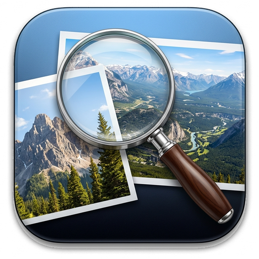

# Preview (macOS Edition for Linux)

A pixel-faithful, high-performance reconstruction of Apple's **macOS Preview.app** built for Linux with Python, **PyQt6**, **PyMuPDF**, and **Pillow**.

- **Developer**: Shivam Prasad
- **Powered by**: [TriviLabs.in](https://trivilabs.in)



---

## ✨ Features

### 📄 Document & Image Engine
- **Multi-page PDF Engine**: Powered by `PyMuPDF` with crisp high-DPI rasterization, multi-page navigation, page rotation, and text extraction.
- **Universal Image Support**: Fast viewing and editing of PNG, JPEG, WEBP, GIF, BMP, and TIFF files via Pillow.
- **High-DPI Retina Rendering**: Clean anti-aliased display output at any zoom scale (10% to 1000%).
- **Interactive Thumbnails Sidebar**: Collapsible left sidebar with page preview thumbnails and Table of Contents (PDF bookmarks).

### 🖌️ Apple Markup & Annotation Toolbar
Toggle with `Ctrl + Shift + A` or the pencil icon:
- **Redaction Tool**: Solid blackout marker for permanently obscuring sensitive data (credit cards, passwords, names).
- **Sketch / Pen**: Smooth freehand vector drawings with customizable stroke widths and colors.
- **Highlighter**: Translucent highlighter pen for marking text or image areas.
- **Shapes**: Rectangle, Rounded Rectangle, Oval/Circle, Line, and Arrow with arrowheads.
- **Text Box**: Insert styled text annotations directly on documents.
- **Sticky Notes**: macOS yellow sticky notes with folded corners and expandable content.
- **Signatures**: Interactive trackpad/mouse signature drawing pad with save and insert.
- **Cropping & Marquee Selection**: Drag-to-select marquee box with 8 resize handles and instant crop execution.

### 🔍 Advanced Tools & Productivity
- **Interactive Magnifier / Loupe Tool (`~`)**: Real-time circular magnifying glass with authentic glass rim, reticle, and drop shadow.
- **Fullscreen Slideshow Mode (`F11`)**: Borderless presentation mode with floating glass HUD and auto-advance timer.
- **Native Print & Print Preview (`Ctrl + P` / `Ctrl + Shift + P`)**: High-resolution printing for all documents and photo galleries.
- **Export as PDF... & Advanced Export Sheet (`Ctrl + Shift + E` / `Ctrl + E`)**: One-click convert to PDF, or export to PNG, JPEG, WebP, TIFF with DPI and compression control.
- **Live Text Extraction (`Ctrl + Shift + C`)**: Extract and copy selectable page text or entire document text to clipboard.
- **Sidebar Page Management**: Right-click any thumbnail to Delete, Duplicate, Insert Blank Page, or Rotate.
- **Open Recent Menu**: Automatically tracks and remembers the last 10 opened documents and folders.
- **PDF Text Search**: Live search bar highlighting matching query occurrences across pages.
- **Inspector Window (`Ctrl + I`)**: Detailed file stats, dimensions, DPI, color space, author, creator, and PDF metadata.

### 🎨 Apple Adjust Color & Size
- **Adjust Color Panel (`Ctrl + Alt + C`)**: Real-time multi-channel RGB histogram, Exposure, Contrast, Highlights, Shadows, Saturation, Temperature, Tint, Sharpness, Sepia, and instant **Auto Levels**.
- **Adjust Size Panel (`Ctrl + Alt + S`)**: Preset dimensions (Full HD, 4K, 1024×768), proportional aspect ratio locking, pixels/percent unit conversion, and real-time output size estimation.

### 🌗 macOS Sequoia Aesthetics
- Unified macOS toolbar with traffic light controls.
- Dynamic **Dark Mode** and **Light Mode** switching.
- Drag-and-drop support: drop any PDF or image into the window to open immediately.

---

## 🚀 Quick Start

### 1. Requirements
Ensure Python 3 and the required dependencies are installed:
```bash
pip install PyQt6 pymupdf pillow
```

### 2. Run the Application
You can launch Preview directly or pass a document or image path:
```bash
# Launch empty
./run.sh

# Or open a PDF or image
./run.sh ~/Downloads/document.pdf
./run.sh ~/Pictures/wallpaper.png
```

Or run with Python directly:
```bash
python3 main.py [optional_path]
```

---

## 📦 Installable Packages (Linux & Windows)

### 🐧 Linux Installation (.deb)
A pre-built Debian package is located in `dist/preview-app_1.2.1_amd64.deb`.
To install it on Debian, Ubuntu, Kali, Linux Mint, or Pop!_OS:
```bash
sudo dpkg -i dist/preview-app_1.2.1_amd64.deb
```
Or rebuild the `.deb` package anytime with a single command:
```bash
./build_deb.sh
```

### 🪟 Windows Setup Installer
1. On a Windows PC, run:
   ```cmd
   windows\build_win.bat
   ```
2. Compile `windows\setup.iss` with [Inno Setup](https://jrsoftware.org/isdl.php) to generate `dist\Preview-Setup-v1.2.1.exe`.
3. Automated GitHub Actions will also build both `.deb` and Windows `.exe` installers automatically on push.

---

## ⌨️ Keyboard Shortcuts

| Shortcut | Action |
| :--- | :--- |
| `Ctrl + O` | Open File... |
| `Ctrl + Shift + O` | Open Folder of Images... |
| `Ctrl + S` | Save |
| `Ctrl + Shift + S` | Save As... |
| `Ctrl + Shift + E` | Export as PDF... |
| `Ctrl + E` | Export... (Format, Quality, DPI Sheet) |
| `Ctrl + P` | Print Document... |
| `Ctrl + Shift + P` | Print Preview... |
| `Ctrl + Shift + C` | Copy Current Page Text |
| `F11` / `Ctrl + Shift + F` | Toggle Fullscreen Slideshow |
| `~` / `` ` `` | Toggle Magnifier / Loupe Tool |
| `Ctrl + B` | Toggle Sidebar |
| `Ctrl + +` / `Ctrl + =` | Zoom In |
| `Ctrl + -` | Zoom Out |
| `Ctrl + 0` | Actual Size (100%) |
| `Ctrl + 9` | Zoom to Fit |
| `Ctrl + L` | Rotate Left 90° |
| `Ctrl + R` | Rotate Right 90° |
| `Ctrl + K` | Crop Selected Box |
| `Ctrl + Shift + A` | Toggle Markup Toolbar |
| `Ctrl + Alt + C` | Adjust Color... |
| `Ctrl + Alt + S` | Adjust Size... |
| `Ctrl + I` | Show Inspector |
| `Space + Drag` | Pan / Hand Tool |
| `Delete` / `Backspace` | Delete Selected Annotation / Page |
| `Ctrl + Z` | Undo |
| `Ctrl + Shift + Z` | Redo |
| `Ctrl + Q` | Quit |

---

## 📁 Project Architecture

```
preview-macos/
├── main.py                     # Application entry point
├── run.sh                      # Shell launcher script
├── preview.desktop             # Linux desktop menu entry
├── requirements.txt            # Python dependencies
├── README.md                   # Documentation
└── preview/
    ├── theme.py                # macOS Dark & Light stylesheets
    ├── icons.py                # Vector SF Symbols icon generator
    ├── core/
    │   ├── document.py         # Unified PDF & Image document model
    │   ├── annotations.py      # Vector annotations & markup engine
    │   ├── color_adjust.py     # Image filtering & histogram engine
    │   └── history.py          # Undo/Redo command manager
    ├── ui/
    │   ├── main_window.py      # Main macOS window with unified toolbar
    │   ├── mac_sidebar.py      # Collapsible thumbnails & outline sidebar
    │   ├── canvas.py           # Interactive high-DPI rendering canvas
    │   ├── markup_toolbar.py   # Secondary annotation & style toolbar
    │   ├── adjust_color_dialog.py # Apple Adjust Color modal with histogram
    │   ├── adjust_size_dialog.py  # Apple Adjust Size modal
    │   ├── signature_dialog.py # Vector signature drawing & stamping pad
    │   └── inspector_dialog.py # Document & PDF metadata inspector
    └── assets/
        └── icon.png            # macOS squircle app icon
```
