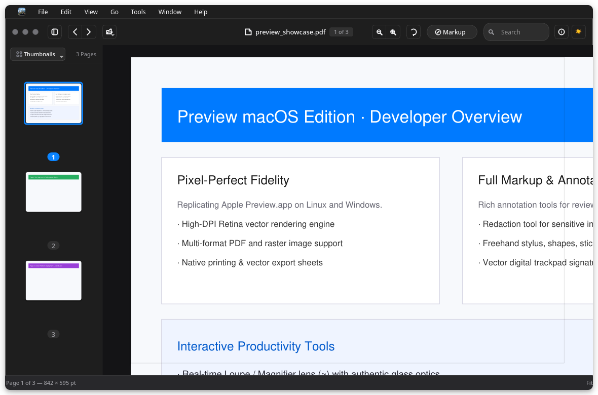
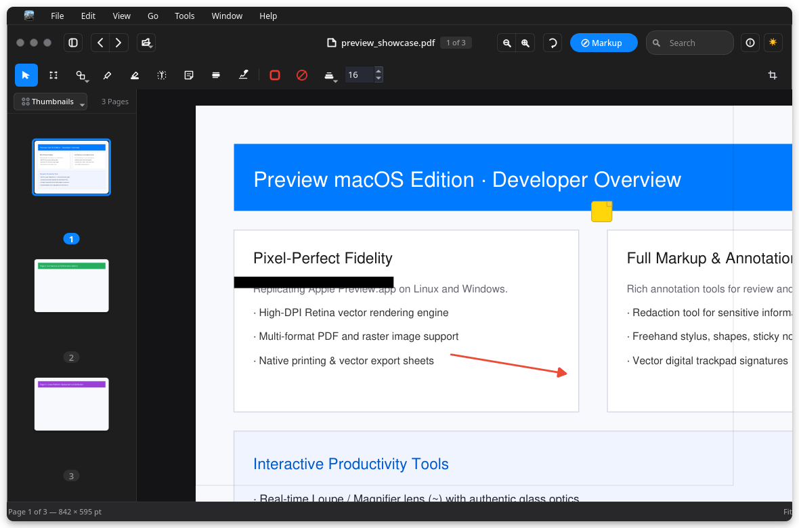
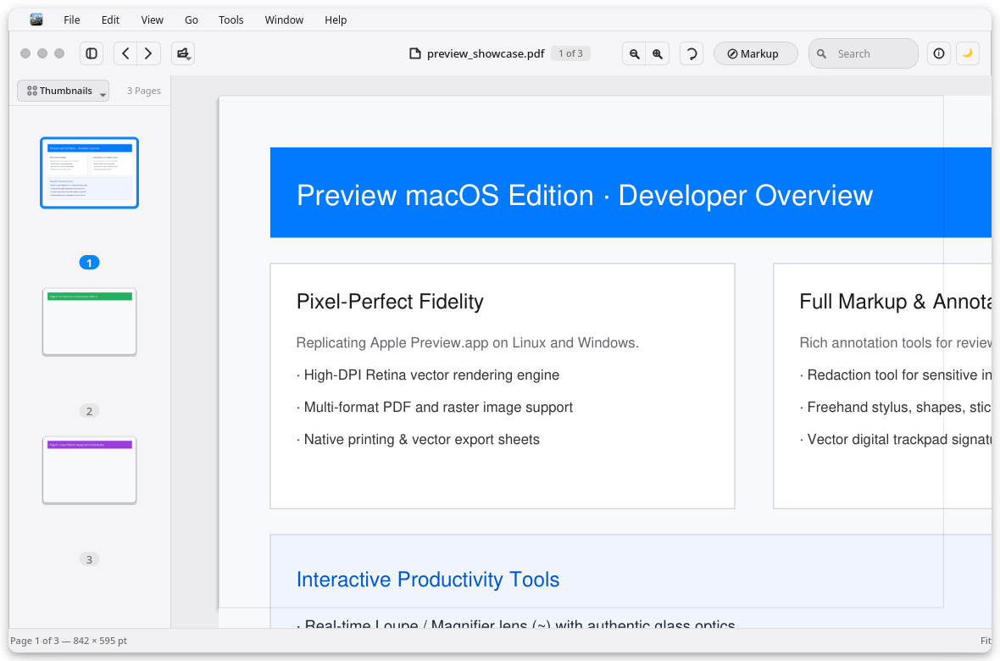
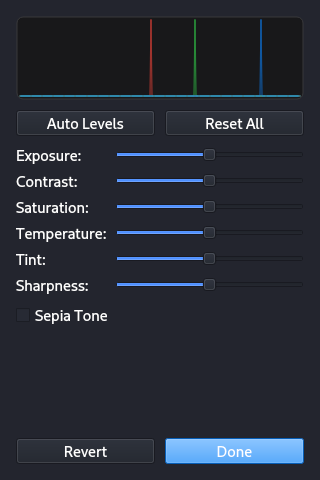
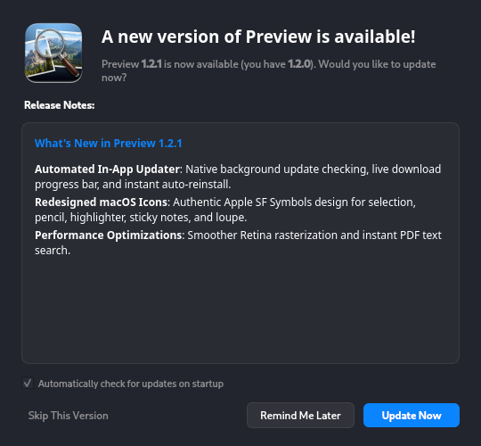

<p align="center">
  
</p>

<h1 align="center">Preview (macOS Edition)</h1>

<p align="center">
  <strong>A pixel-faithful, high-performance reconstruction of Apple's macOS Preview app for Linux and Windows.</strong>
</p>

<p align="center">
  <a href="https://github.com/shivamprasad1001/previewmacos/releases"></a>
  <a href="https://github.com/shivamprasad1001/previewmacos/actions"></a>
  <a href="https://python.org"></a>
  <a href="https://riverbankcomputing.com/software/pyqt"></a>
  <a href="LICENSE"></a>
  <a href="https://trivilabs.in"></a>
</p>

<p align="center">
  <a href="#-quick-download"><strong>Quick Download</strong></a> •
  <a href="#-features"><strong>Features</strong></a> •
  <a href="#-visual-tour"><strong>Visual Tour</strong></a> •
  <a href="#-feature-comparison"><strong>Comparison</strong></a> •
  <a href="#-installation"><strong>Installation</strong></a> •
  <a href="#-keyboard-shortcuts"><strong>Shortcuts</strong></a> •
  <a href="#-architecture"><strong>Architecture</strong></a>
</p>

---

## 📥 Quick Download

Get the official multiplatform installer for your operating system:

| Platform | Package | Download Link |
| :--- | :--- | :--- |
| **Ubuntu / Debian / Kali / Mint** | `.deb` Package | [**Download preview-app_1.2.1_amd64.deb**](https://github.com/shivamprasad1001/previewmacos/releases/download/v1.2.1/preview-app_1.2.1_amd64.deb) |
| **Windows 10 / 11** | Setup Installer | [**Download Preview-Setup-v1.2.1.exe**](https://github.com/shivamprasad1001/previewmacos/releases/download/v1.2.1/Preview-Setup-v1.2.1.exe) |
| **All Platforms (Source)** | Python 3.10+ | [**GitHub Source Repository**](https://github.com/shivamprasad1001/previewmacos) |

---

## 📸 Hero Showcase

<p align="center">
  
  <br />
  <em>macOS Sequoia Dark Mode with Unified Traffic Light Controls, Thumbnail Sidebar, and Document HUD</em>
</p>

---

## ✨ Features

### 📄 Universal Document & Image Engine
- **Crisp Multi-Page PDF Engine**: High-DPI anti-aliased vector rendering powered by `PyMuPDF`. Smooth page navigation, rotation, and sub-pixel text rendering.
- **Universal Image Format Support**: Lightning-fast loading for PNG, JPEG, WebP, GIF, BMP, TIFF, and ICO formats via Pillow.
- **Dynamic Retina Scaling**: Crystal-clear scaling from 10% to 1000% zoom with automatic aspect ratio preservation and continuous document panning.
- **Collapsible Sidebar**: Authentic macOS thumbnail drawer with badge counters, page reordering, duplication, rotation, and deletion.
- **PDF Text Search**: Live search bar with instant jump-to-result navigation across document pages.

### 🖌️ Apple Markup & Annotation Suite
Toggle the secondary markup toolbar with `Ctrl + Shift + A`:
- **Redaction Tool (Blackout Marker)**: Solid blackout tool for securely sanitizing private data (credit card numbers, passwords, identifiers) prior to exporting.
- **Apple Pencil Stylus**: Freehand pen tool with customizable stroke widths and calibrated macOS color palettes.
- **Highlighter Pen**: Semi-translucent highlighter for text and diagram highlighting.
- **Vector Shapes**: Rectangle, Rounded Rectangle, Oval/Circle, Line, and Directional Arrow with sharp arrowheads.
- **Text Box Annotator**: Add formatted typography overlays directly onto pages and pictures.
- **macOS Sticky Notes**: Signature yellow Post-it notes with folded corners and expandable comments.
- **Digital Signatures**: Interactive trackpad/mouse signature capture pad with permanent signature library and stamp placement.
- **Marquee Selection & Instant Crop (`Ctrl + K`)**: Drag-to-select marquee box with 8-handle anchor resizing and lossless image cropping.

### 🔍 Precision Productivity Tools
- **Interactive Magnifier / Loupe Tool (`~` or `` ` ``)**: Real-time circular magnifying glass with authentic Apple glass rim, crosshair reticle, and soft drop shadow.
- **Fullscreen Slideshow Mode (`F11`)**: Distraction-free presentation mode with dark borderless background, keyboard navigation, and floating glass control HUD.
- **Live Text Extraction (`Ctrl + Shift + C`)**: One-click OCR-free text extraction from any PDF page directly to the system clipboard.
- **Native Print & Print Preview (`Ctrl + P` / `Ctrl + Shift + P`)**: High-resolution print engine with full page layout, orientation, and margin controls.
- **Export as PDF & Advanced Export Sheet (`Ctrl + E`)**: Convert any image to PDF, or export documents with configurable DPI, compression quality, and image formats (PNG, JPEG, WebP, TIFF).
- **Inspector Window (`Ctrl + I`)**: Detailed document metadata inspection including dimensions, DPI resolution, color spaces, author, creator, and timestamps.

### 🎨 Pro Image Adjustment Lab
- **Adjust Color Panel (`Ctrl + Alt + C`)**: Interactive real-time RGB color histogram, Exposure, Contrast, Highlights, Shadows, Saturation, Temperature, Tint, Sharpness, Sepia, and instant **Auto Levels**.
- **Adjust Size Panel (`Ctrl + Alt + S`)**: Preset resolution templates (Full HD, 4K, 1024×768), proportional aspect ratio locking, pixels/percentage unit switching, and live file size estimation.

### 🔄 Sparkle-Style In-App Software Updater
- **Automated Update Checking**: Background checking on startup and manual check via menu item.
- **In-App Download Sheet**: Real-time progress bar displaying download speed, percentage, and formatted release notes.
- **One-Click Native Reinstall**: Automatically invokes native package managers (`dpkg` via `pkexec` on Linux, silent installer on Windows) and relaunches the application.

---

## 🖼️ Visual Tour

| Apple Markup Toolbar & Annotations | macOS Light Mode Interface |
| :---: | :---: |
|  |  |
| *Redaction marker, sticky notes, and vector shapes* | *Clean, authentic macOS Light Mode interface* |

| Image Color Adjustment & Histogram | Sparkle-Style In-App Auto-Updater |
| :---: | :---: |
|  |  |
| *Real-time RGB histogram, exposure, and auto-levels* | *Live in-app download and native auto-relaunch* |

---

## 📊 Feature Comparison

| Feature | macOS Preview | **Preview (This App)** | Evince / GNOME Document Viewer | Okular | Eye of GNOME (eog) |
| :--- | :---: | :---: | :---: | :---: | :---: |
| **macOS Sequoia Unified UI** | ✅ | ✅ | ❌ | ❌ | ❌ |
| **Multi-Page PDF & Image Support** | ✅ | ✅ | PDF only | Mixed | Images only |
| **Redaction Tool (Data Blackout)** | ✅ | ✅ | ❌ | ❌ | ❌ |
| **Trackpad / Mouse Signature Pad** | ✅ | ✅ | ❌ | ❌ | ❌ |
| **Interactive Loupe / Magnifier Lens** | ✅ | ✅ | ❌ | ❌ | ❌ |
| **Adjust Color (Live RGB Histogram)** | ✅ | ✅ | ❌ | ❌ | ❌ |
| **Proportional Adjust Size Presets** | ✅ | ✅ | ❌ | ❌ | ❌ |
| **Sticky Notes & Vector Annotations** | ✅ | ✅ | Basic | Complex | ❌ |
| **Fullscreen Presentation Slideshow** | ✅ | ✅ | Presentation | Presentation | Slideshow |
| **Sparkle-Style Auto Updater** | ✅ | ✅ | System only | System only | System only |
| **Cross-Platform (Linux & Windows)** | ❌ (macOS only) | ✅ | Linux only | Complex | Linux only |

---

## 🚀 Installation & Running

### 🐧 Linux Installation (.deb Package)

#### Option 1: Install from Release Binary
Download and install the official Debian/Ubuntu package:
```bash
wget https://github.com/shivamprasad1001/previewmacos/releases/download/v1.2.1/preview-app_1.2.1_amd64.deb
sudo dpkg -i preview-app_1.2.1_amd64.deb || sudo apt-get install -f -y
```

#### Option 2: Build Debian Package from Source
```bash
git clone https://github.com/shivamprasad1001/previewmacos.git
cd previewmacos
chmod +x build_deb.sh
./build_deb.sh
sudo dpkg -i dist/preview-app_*.deb
```

---

### 🪟 Windows Installation

1. Download [`Preview-Setup-v1.2.1.exe`](https://github.com/shivamprasad1001/previewmacos/releases/download/v1.2.1/Preview-Setup-v1.2.1.exe).
2. Run the installer wizard and launch **Preview** from your Start Menu or Desktop shortcut.

---

### 🐍 Running from Source (Cross-Platform)

```bash
# 1. Clone repository
git clone https://github.com/shivamprasad1001/previewmacos.git
cd previewmacos

# 2. Set up virtual environment
python3 -m venv .venv
source .venv/bin/activate  # On Windows: .venv\Scripts\activate

# 3. Install dependencies
pip install -r requirements.txt

# 4. Run the application
./run.sh

# Or open a file directly
./run.sh path/to/document.pdf
```

---

## ⌨️ Keyboard Shortcuts

### File & Export
| Shortcut | Action |
| :--- | :--- |
| `Ctrl + O` | Open Document or Image... |
| `Ctrl + Shift + O` | Open Directory of Photos as Gallery... |
| `Ctrl + S` | Save Current Document |
| `Ctrl + Shift + S` | Save As... |
| `Ctrl + Shift + E` | Quick Export as PDF... |
| `Ctrl + E` | Advanced Export Sheet (Format, DPI, Quality) |
| `Ctrl + P` | Native Print Document... |
| `Ctrl + Shift + P` | Print Preview Sheet... |
| `Ctrl + Shift + C` | Copy Current Page Text to Clipboard |
| `Ctrl + Q` | Quit Application |

### Viewing & Navigation
| Shortcut | Action |
| :--- | :--- |
| `Ctrl + +` / `Ctrl + =` | Zoom In |
| `Ctrl + -` | Zoom Out |
| `Ctrl + 0` | Actual Size (100% Zoom) |
| `Ctrl + 9` | Zoom to Fit Window |
| `Ctrl + B` | Toggle Thumbnail Sidebar |
| `F11` / `Ctrl + Shift + F` | Toggle Fullscreen Slideshow |
| `~` / `` ` `` | Toggle Loupe / Magnifier Lens |
| `Space + Drag` | Pan Document (Hand Tool) |
| `Ctrl + L` / `Ctrl + R` | Rotate Left / Right 90° |
| `Left` / `Right` Arrow | Previous / Next Page |

### Markup & Image Adjustments
| Shortcut | Action |
| :--- | :--- |
| `Ctrl + Shift + A` | Show / Hide Markup Toolbar |
| `Ctrl + K` | Crop Selected Marquee Rectangle |
| `Ctrl + Alt + C` | Open Adjust Color Panel & Histogram |
| `Ctrl + Alt + S` | Open Adjust Size Panel |
| `Ctrl + I` | Open Document & PDF Inspector |
| `Ctrl + Z` | Undo Last Edit |
| `Ctrl + Shift + Z` | Redo Edit |
| `Delete` / `Backspace` | Delete Selected Annotation or Page |

---

## 📁 Architecture & Code Organization

```
preview-macos/
├── main.py                     # High-performance application entry point
├── run.sh                      # Instant shell launcher
├── build_deb.sh                # Automated Debian package builder
├── preview.desktop             # Linux XDG desktop menu definition
├── requirements.txt            # Minimal runtime dependencies
├── test_preview_features.py    # Comprehensive 25-point test suite
├── docs/
│   └── screenshots/            # Showcase documentation media
├── windows/
│   ├── build_win.bat           # Windows PyInstaller build script
│   └── setup.iss               # Inno Setup installer script
└── preview/
    ├── __init__.py             # Dynamic package metadata & version
    ├── theme.py                # macOS Sequoia Dark & Light stylesheet tokens
    ├── icons.py                # Vector SF Symbols iconography generator
    ├── core/
    │   ├── document.py         # Unified PDF & Image dual-engine model
    │   ├── annotations.py      # Vector annotations, hit-testing & serialization
    │   ├── color_adjust.py     # Real-time RGB histogram & Pillow image filters
    │   ├── updater.py          # Sparkle GitHub API updater & background downloader
    │   └── history.py          # Undo/Redo command pattern manager
    └── ui/
        ├── main_window.py      # Unified macOS toolbar, traffic lights, canvas host
        ├── mac_sidebar.py      # Asynchronous thumbnails & outline navigation drawer
        ├── canvas.py           # Interactive high-DPI rasterization & markup canvas
        ├── markup_toolbar.py   # Secondary Apple markup & style control bar
        ├── adjust_color_dialog.py # Interactive RGB color curves & filter window
        ├── adjust_size_dialog.py  # Resolution scaling & unit conversion panel
        ├── signature_dialog.py # Vector trackpad signature pad
        ├── update_dialog.py    # macOS Sparkle update sheet & notification banner
        ├── export_dialog.py    # Multi-format export sheet with DPI control
        ├── about_dialog.py     # Native macOS About sheet
        └── inspector_dialog.py # Document metadata & PDF structure inspector
```

---

## 🧪 Testing & Verification

A dedicated automated test suite validates parity, image decoding, PDF rasterization, undo/redo history, color engines, and updater logic:

```bash
python3 test_preview_features.py
```

All 25 test cases run in headless offscreen mode and complete in under one second.

---

## 🤝 Contributing

Contributions, bug reports, and feature requests are welcome!

1. Check existing issues or open a new [Bug Report](https://github.com/shivamprasad1001/previewmacos/issues/new?template=bug_report.md) or [Feature Request](https://github.com/shivamprasad1001/previewmacos/issues/new?template=feature_request.md).
2. Read our [Contributing Guidelines](CONTRIBUTING.md).
3. Ensure all tests pass prior to submitting your Pull Request.

---

## 👨‍💻 Author & Attribution

- **Lead Developer**: **Shivam Prasad** ([@shivamprasad1001](https://github.com/shivamprasad1001))
- **Powered by**: [**TriviLabs.in**](https://trivilabs.in) — Innovative Engineering & Research

---

## 📄 License

This project is licensed under the **MIT License** — see the [LICENSE](LICENSE) file for details.
